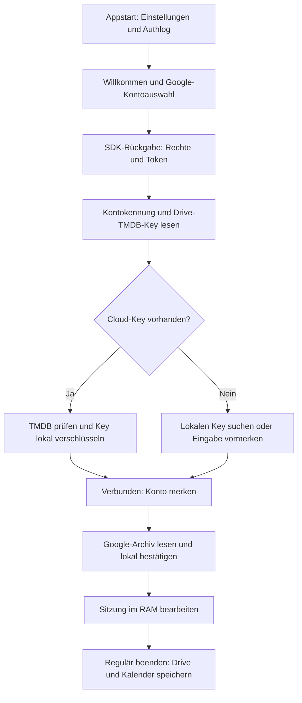

# SerKal Android – erster Start, Speicherorte und Google-Anmeldung
Stand: 20.11.2026. Codeanalyse auf Kurts Auftrag, keine Änderung der App oder Nutzerdaten.

## Geprüfte Fassungen und Reichweite

Thorsten meldet das Problem nach Installation von Android1.2.6 weiterhin.
Geprüfte1.2.6-Quelle: 2043721004a6bbba4faf1454a366c1c9e9d90608 (Code50 Edge).
Vergleich1.2.7: 47f4e2240b089f8cc700f6706af388f2baed6a28 (Code51).
MainActivity-Anmeldeblock sowie KeyCache, SharedKeyClient, AndroidArchiveSession,
SessionArchiveClient und GoogleHttpFailure sind zwischen diesen Quellen identisch.
Keine Gerätebeobachtung bei Thorsten, kein nachgewiesener Fehlergrund.
„Neuinstallation“ bedeutet hier: lokale App-Daten leer; das Google-Konto kann bereits
SerKal-Daten und früher erteilte OAuth-Zustimmungen besitzen.

## 1. Wichtigste Antwort: keine Handyordner freizugeben

Die geprüfte App benutzt für die hier verfolgten eigenen Daten ausschließlich
Androids privaten App-Speicher (getFilesDir/getPreferences/getSharedPreferences)
und AndroidKeyStore. Kein Dokumenten-/Downloadordner wird beim Einstieg ausgewählt.
Kein lokaler Kalender-Provider wird für die API-Synchronisierung beschrieben.
Das eigene AndroidManifest deklariert ausschließlich INTERNET; keine
READ/WRITE_EXTERNAL_STORAGE-, MANAGE_EXTERNAL_STORAGE- oder READ/WRITE_CALENDAR-Rechte.
Das ist die Prüfung des eigenen Manifests und der Anwendungspfade, keine neue
Analyse des vollständig zusammengeführten APK-Manifests samt SDK-internen Dateien.

Android benötigt für seinen appinternen Speicher keine vom Nutzer zu vergebenden
Dateirechte. Google-OAuth-Zustimmungen sind davon getrennt. Eine fehlende manuelle
Ordnerfreigabe ist deshalb für diesen Ablauf keine passende Erklärung.
Gerätefehler, voller Speicher, Keystorefehler und Programmblockaden sind damit
nicht ausgeschlossen; sie müssten konkret nachgewiesen werden.

## 2. Startreihenfolge aus MainActivity

| Schritt | Aufruf / Handlung | Lesen | Schreiben |
|---|---|---|---|
| 1 | onCreate, Zeilen904–913 | Activity-Preferences: english (Standardfalse), dark (Standardtrue), googleAttemptPending | Nach Aufbau der Oberfläche APP_START in google-auth.jsonl. |
| 2a | Voriger Versuch war unterbrochen | ggf.lastOwner, lastEmail, bestätigtes lokales Archiv/KeyCache | Pending-Marker wird zurückgesetzt, PREVIOUS_ATTEMPT_INTERRUPTED protokolliert. Kein automatischer neuer Login in diesem Zweig; Menü > Google-Konto. |
| 2b | Normaler erster Start: connectGoogle(false) | googleWelcomeAccepted (Standardfalse) | Noch keine Cloud-Schreibaktion. |
| 3 | Willkommen mit Rechteerklärung; Weiter zu Google | Entscheidung des Nutzers | googleWelcomeAccepted=true in Activity-Preferences. „Später“ versucht nur lokale Wiederherstellung; ohne lastOwner gibt es keine. |
| 4 | connectGoogle | Google-Play-Services-Autorisierung anfordern | googleAttemptPending=true; STEP/authorize im Authlog; Anzeige „Google wird verbunden“. |
| 5 | SDK verlangt Konto/Rechte: startIntentSenderForResult, Request505 | Google-SDK zeigt Konto-/Zustimmungsoberfläche | STEP/account_and_permissions im Authlog. Google verwaltet eigene Kontodaten außerhalb unserer Dateiliste. |
| 6 | onActivityResult, danach useGoogleResult | SDK-Rückgabestatus, GrantedScopes und AccessToken | ACTIVITY_RESULT..., STEP/permissions_returned, CALENDAR_PERMISSION... im Authlog. Bei fehlenden Rechten/Token Fehlerrückweg. |
| 7 | SharedKeyClient.identify im Netzwerk-Worker | GET https://www.googleapis.com/oauth2/v3/userinfo: sub, email, email_verified | IDENTITY_REQUEST/IDENTITY_OK im Authlog. Noch kein Archiveintrag. |
| 8 | SharedKeyClient.load | Drive-Dateiliste in appDataFolder nach serkal-tmdb-key-v1.json; danach Dateiinhalte. Eigentümer/Schema/eindeutiger Key werden geprüft. | DRIVE_KEY_REQUEST, DRIVE_KEY_OK oder DRIVE_KEY_FAILED. Reines Lesen, kein automatisches Anlegen der Keydatei. |
| 9a | Cloud-Key vorhanden | TMDB GET /3/configuration zur Gültigkeitsprüfung | TMDB_VALIDATE_REQUEST/OK; anschließend verschlüsselter lokaler KeyCache, ggf.Keystore-Schlüsselanlage. |
| 9b | Kein Cloud-Key | Lokalen KeyCache für genau diesen owner lesen; bei echter Erstinstallation leer | Bei leerem Cache weder Keystore-Anlage noch KeyCache-Schreiben in diesem Pfad. |
| 10 | UI-Rückgabe nach erfolgreicher Verarbeitung | user/Key-Ergebnis aus Worker | CONNECTED; Pending=false; lastOwner und lastEmail in Preferences; Token nur im Anwendungsspeicher. Danach loadArchive(). |
| 11 | AndroidArchiveSession-Konstruktor | Eventuelle lokale Kalender-Restliste, bestätigter Archivcache; optional alter archive-copy-Cache | Nur bei Fehlern ggf.Sessionlog. Zunächst leeres Arbeitsarchiv im RAM. |
| 12 | schedule/load im eigenen Archiv-Worker | Erneut userinfo zum Kontovergleich; Drive-Sitzungsdatei oder alte Snapshotdatei lesen | Nach erfolgreicher Prüfung lokale session-confirmed-Datei atomar schreiben; SESSION_LOADED im Sessionlog. |
| 13 | Bedienoberfläche zeigt Archiv und TMDB-Status | Archiv aus Arbeitssitzung | Keine Kalenderschreibaktion beim normalen Archivladen. |

Schritte11/12 starten asynchron. Die anschließende Anzeige des TMDB-Status in
MainActivity kann deshalb vor dem Abschluss des Archivdownloads erscheinen.
„CONNECTED“ bedeutet hier: eigener Anmelde-/Keyvorlauf beendet; nicht bereits
„Archiv erfolgreich geladen“ oder „Kalender erfolgreich geschrieben“.

### Google-Rechte im Request

- drive.appdata: SerKals verborgener eigener App-Datenbereich in Google Drive.
- openid und userinfo.email: Kontozuordnung/Identität.
- calendar.app.created: von der App erzeugte Kalender und deren Termine.
- calendar.calendarlist.readonly: Kalenderliste lesen.
- useGoogleResult prüft die drei Drive-/Kalender-Scopes ausdrücklich vor unseren
  HTTP-Anfragen; unvollständige Zustimmung führt GOOGLE_PERMISSION_MISSING.
  Das sind keine freizugebenden Smartphoneordner.

## 3. Lokale Speicherkarte

Beispiel für Hauptnutzer0:
BASIS = /data/user/0/de.serkal.android.preview.v005/
Der echte Pfad wird von Android geliefert; andere Android-Nutzer/Arbeitsprofile können
abweichende Pfade haben. Nicht manuell erstellen, per Dateimanager freigeben oder umbenennen.
Der Hauptordner wird von Android verwaltet; Daten entstehen erst nach Bedarf.

| Ablage unter BASIS | Inhalt | Wann |
|---|---|---|
| shared_prefs/MainActivity.xml | Android-Activity-Preferences: Sprache, Thema, Begrüßung bestätigt, Login-versucht-Marker, später lastOwner/lastEmail; außerdem Sortierung, Wartungsland/-bericht bei späterer Benutzung. | Erste dauerhafte Einstellungen beim Willkommen/Anmeldebeginn. XML-Dateiname ist Framework-Konvention für getPreferences(), kein im Appcode hart kodierter Pfad. |
| shared_prefs/serkal_key_cache.xml | Feld encrypted: IV und AES-GCM-verschlüsseltes JSON aus owner und apiKey. | Erst nach erfolgreicher Übernahme/Prüfung eines vorhandenen Cloud-Keys oder manueller gültiger Eingabe mit bekanntem owner. |
| files/google-auth.jsonl | APP_START und Stufen/Rückgaben/Timeout/Abbruch mit Version, Gerät und Zeiten. | Ab Start nach buildScreen; Anhängen je Ereignis. |
| files/google-auth-previous.jsonl | Vorherige Authlogdatei. | Rotation bei mehr als262144Bytes im aktuellen Authlog. |
| files/google-errors.jsonl | Exceptiontyp, bereinigte Meldung, ggf.Google-HTTP-Endpunkt/-Antwort oder SDK-Statuscode. | Nur im Fehlerfall, nicht zwingend bei erfolgreichem Einstieg vorhanden. |
| files/session-confirmed-H.json | Zuletzt bestätigter Gesamtarchivstand; inkl.files[] mit Namen, Textinhalten, Hashes und calendar.mode/id. | Nach erfolgreichem Google-Laden (auch leeres Archiv) und nach regulärem erfolgreichen Speichern. AtomicFile, temporäre Hilfsdateien möglich. |
| files/serkal-session-log-H.jsonl | Archiv-/HTTP-Phasen, Laden/Speichern, später Kalenderplan/-Operationen/-Fehler. | Ab tatsächlich protokollierter Archivoperation. |
| files/session-calendar-pending-H.json | pending=true und noch offene Kalenderbereiche (scopes). | Beim normalen Abschluss mit Kalenderänderungen; nach Erfolg gelöscht. Kein reguläres Erstanmeldeprodukt. |
| files/archive-copy-H.json | Historischer Cache; ggf.nur als Migrationsquelle gelesen. | Kein neu angelegtes aktuelles Sitzungsarchiv. |

H = SHA-256 der Google-Kontokennung sub/owner, nicht der Mailadresse.
Der Verschlüsselungsschlüssel liegt zusätzlich unter AndroidKeyStore-Alias
serkal.tmdb.cache.v1. Das ist kein freizugebender Ordner und keine Passwortdatei.
KeyCache.commit()==false ergibt CACHE_SAVE_FAILED; Keystore-Ausnahmen werden ebenfalls
weitergereicht. Google-Passwort wird von SerKal nicht gespeichert; der erhaltene
AccessToken bleibt in diesen Anwendungspfaden im RAM. SDK-interne Token-/Kontoverwaltung
ist Google Play Services überlassen, deren Dateien sind hier nicht inventarisiert.

Poster werden über ein LruCache im RAM gehalten; im untersuchten MainActivity-Pfad
gibt es dafür keine Posterdateien auf dem Handyspeicher.

## 4. Was liegt bei Google?

### Drive – verborgener appDataFolder, kein sichtbarer freizugebender Drive-Ordner

- serkal-tmdb-key-v1.json: schema1, owner, apiKey. Beim normalen Einstieg nur gelesen.
  Dateiinhalt enthält den Key als JSON; die zusätzliche AES-Verschlüsselung betrifft
  den lokalen Cache, nicht diese Cloud-Datei. Zugriffsschutz über Drive-Appdatenbereich.
- serkal-session-v1.json: gesamtes gemeinsames Archiv, schema2, Archivstand38,
  owner, revision, generatedAt, files[], calendar. Beim Start nur gelesen.
  Existiert sie nicht, versucht der Client den neuesten alten serkal-copy-v2-*.json-
  Snapshot; gibt es auch den nicht, entsteht ein leeres Archiv zunächst nur lokal/RAM.
- Alte Snapshotnamen serkal-copy-v2-*.json sind Importquellen. Der heutige Einstieg
  ruft die alte komplette Revisionsketten-/Konfliktprüfung nicht auf.

Der Appdatenbereich wird von Drive bei der ersten Dateianlage bereitgestellt.
Ein frisches Konto ohne SerKal-Dateien ist ein vorgesehener leerer Fall, kein Grund,
erst Dummydateien im sichtbaren Drive anzulegen.

### TMDB-Eingabe nach erstmaliger Google-Anmeldung

1. Nutzer gibt eigenen TMDB-Key/Read-Token ein; leere Eingabe wird im Dialog abgewiesen.
2. TMDB /configuration validiert ihn.
3. Bei bekanntem Google-owner lokal verschlüsselt speichern; ohne owner in diesem
   Codepfad nur credential im RAM, keine dauerhafte kontobezogene Speicherung.
4. Dialog fragt getrennt „Diesen Schlüssel für weitere Installationen bereitstellen?“.
5. Nur nach Zustimmung: vorhandenen Cloud-Key lesen, Konflikte verhindern, Key
   nochmals validieren, fehlende serkal-tmdb-key-v1.json anlegen, erneut lesen/verifizieren,
   lokalen Cache aktualisieren. Keinen bestehenden anderen Cloud-Key still überschreiben.

### Normaler Sitzungsabschluss, kein Anmeldeschritt

Während Bearbeitung bleiben Änderungen am Arbeitsarchiv im RAM.
Bei „SerKal beenden“: Google-Zugriff erneut anfordern/auffrischen (max.10s vorgesehen),
dann Session.finish. Nur bei Änderungen oder offenen Kalenderarbeiten:
Kontovergleich; falls Kalenderänderungen ein Kalenderziel brauchen, SerKal-Kalender
in Liste suchen oder anlegen; Restmarker lokal setzen; geändertes Gesamtarchiv bei
Drive speichern (PATCH vorhandener Datei, sonst POST); betroffene Kalendertermine
abgleichen; Restmarker aktualisieren/löschen; bestätigten Stand lokal schreiben.
Die Kalendereinträge sind Google-Calendar-API-Objekte, keine lokalen Termindateien.
Keine manuelle Handy-Kalenderfreigabe für diesen Weg erforderlich.
Ohne Änderungen/Reste werden weder Gesamtarchiv noch Kalender neu geschrieben.
Wegwischen ist nicht automatisch dieser reguläre Abschluss; ungespeicherte RAM-Arbeit
ist keine bestätigte lokale Sicherung.

## 5. Ablaufbild

## 6. Einordnung von Thorstens Hänger

Ein Spinner beweist weder einen Dateirechtefehler noch überhaupt einen begonnenen
Drivezugriff. Solange der Google-Kontodialog noch offen ist und unser SDK-Rückweg
nicht läuft, wurden die späteren Archive-/Kalenderdateien noch gar nicht angelegt.
Sicherheitsprüfung, SDK-Rückgabe/Lifecycle, Netzwerkwarten, UI-Blockaden und lokale
Speicher-/Keystorefehler sind unterschiedliche Möglichkeiten.

Konkrete Diagnose über vorhandene Stufen:
- STEP/authorize: SDK-Aufruf. Vorgesehene Grenze45s.
- STEP/account_and_permissions: Google-Konto-/Rechteoberfläche. Grenze120s.
- ACTIVITY_RESULT_...: Rückkehr aus genau dieser Oberfläche.
- STEP/permissions_returned: eigene Verarbeitung danach; Grenze60s für diesen Vorlauf.
- IDENTITY_OK: userinfo erfolgreich.
- DRIVE_KEY_OK/FAILED: Schlüsselabruf beendet.
- TMDB_VALIDATE_OK: nur falls Cloud-Key vorhanden.
- CONNECTED: eigener Loginvorlauf fertig; danach ARCHIVE_LOAD_SCHEDULED.
- Sessionlog: PHASE_END identity-http/archive-http, danach SESSION_LOADED bzw.SESSION_LOAD_FAILED.

Eigene SharedKeyClient-/TMDB-Verbindungen haben10s Verbindungs- und15s Lesezeitlimit;
SessionArchiveClient15s Lesezeitlimit, maximal10s Verbindungsaufbau je Anfrage.
Das sind keine garantierten Gesamtdauern aller Seiten/Anfragen; der Start-Archivdownload
hat hier keine eigene Gesamtabbruchfrist. Ein Netzwerk-Lesetimeout begrenzt nicht
automatisch eine komplette Folge vieler erfolgreicher Teilantworten.
Die UI-Timeouts laufen auf dem Main-Handler: ein blockierter UI-Thread kann auch
deren sichtbare Reaktion verzögern. Das ist eine Möglichkeit, kein Nachweis auf Thorstens Gerät.

Zwei tatsächlich erkennbare Kopplungen/Grenzen:
1. Ein vorhandener Cloud-TMDB-Key wird vor CONNECTED gegen TMDB validiert und lokal
   per Keystore gespeichert. Ein Fehler dort führt zum allgemeinen Google-Fehlerrückweg;
   „Google-Anmeldung fehlgeschlagen“ muss also nicht ausschließlich Google bedeuten.
   Bei wirklich neuem Konto ohne Cloud-Key wird dieser Schreibpfad übersprungen.
2. Die Logschreiber verschlucken eigene Dateischreibfehler mit catch(Exception ignored).
   Ein leeres Log beweist daher nicht „keine Aktivität“. Authlog sollte bereits APP_START
   zeigen; Fehler beim Logschreiben bleiben aber selbst ungemeldet. Ein verbesserter
   Diagnose-/Exportpfad wäre eine separate Codeänderung, hier nicht umgesetzt.

MainActivity Menü > Log zeigt Auth-/Googlefehlerlog auch ohne archiveCopy an;
mit Archivsession zusätzlich deren Sessionlog. Text ist auswählbar. Im geprüften
Dialog existiert kein eigener Exportknopf. Thorsten muss zunächst seine bereits
erhaltene Anfrage beantworten; nicht mit neuen Neuinstallationen bedrängen.
Der frische Bericht ist mit Thorsten unterschrieben; frühere Philipp-Bezeichnung
nicht ohne Klärung als dieselbe Person/Gerät ausgeben.

## 7. Quellen

Code jeweils auf dem fixierten1.2.6-Stand:
- [MainActivity: Start](https://github.com/KurtV731/serkal_desktop/blob/2043721004a6bbba4faf1454a366c1c9e9d90608/android-preview/app/src/main/java/de/serkal/android/preview/MainActivity.java#L904)
- [MainActivity: Anmeldung](https://github.com/KurtV731/serkal_desktop/blob/2043721004a6bbba4faf1454a366c1c9e9d90608/android-preview/app/src/main/java/de/serkal/android/preview/MainActivity.java#L168)
- KeyCache.java; SharedKeyClient.java; AndroidArchiveSession.java; SessionArchiveClient.java;
  GoogleHttpFailure.java; ArchiveCopyClient.java; ArchiveCodec.java; TmdbClient.java
  im selben Java-Verzeichnis; AndroidManifest.xml unter android-preview/app/src/main/.
- https://developer.android.com/training/data-storage/app-specific
- https://developers.google.com/workspace/drive/api/guides/appdata

Ergebnis ist eine nachvollzogene Codekarte, keine fertige Fehlerbehebung oder neue Freigabe.
